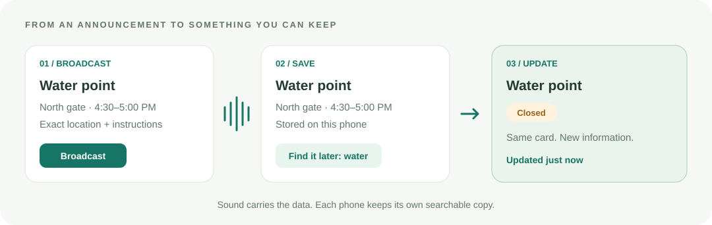

<p align="center">
  
</p>

<h1 align="center">Chirp</h1>
<p align="center"><strong>Public announcements, saved on your phone.</strong></p>
<p align="center">Send useful disaster information through sound. Keep it, find it, and receive updates—even without a network after initial setup.</p>
<p align="center">
  <a href="https://chirp-offline-relief.socialmacaw16.chatgpt.site/">Try the live demo</a> ·
  <a href="#try-it-in-a-minute">Quick walkthrough</a> ·
  <a href="#run-locally">Developer setup</a> ·
  <a href="AGENTS.md">Agent guide</a>
</p>



## Why Chirp?

“Water is available at the north gate until five.” An announcement is useful—but someone might
miss the time, forget the location, or never hear that the collection point has closed.

Chirp sends the details directly to nearby listening phones as sound. They become searchable
cards with exact coordinates, hours, contacts and instructions. A later broadcast updates the
same card, so people can find the latest information **their phone has received**.

Built by [Niranjan](https://github.com/vsniranjan) for **Devin Hack Kochi**, track **Works Anyway**.
The constraint: **no network for transferring information**. The website must be loaded beforehand.

## What you can do

| Share | Keep on the receiving phone |
| --- | --- |
| **Places** | Shelter or meeting-point details, coordinates and an **Open in Maps** button |
| **Supplies** | Distribution points, collection hours and short instructions |
| **Contacts** | A saved phone number and a **Call** button |
| **Instructions** | Short notes people can look up later |

Cards have **Active**, **Closed** or **Withdrawn** status. Receivers save them automatically,
show visible updates, and support keyword search and category filters. Older or duplicate
versions do not overwrite a newer version already saved on that phone.

**Why sound?** One broadcast can reach multiple listening phones without camera aiming or
Bluetooth pairing. QR codes also work offline and may be better in some settings. Chirp explores
sound as another way to distribute small, actionable records.

## Try it in a minute

Use two phones with Chrome. Start close together in a quiet space.

1. Open **[Chirp](https://chirp-offline-relief.socialmacaw16.chatgpt.site/)** on both phones while online.
2. Receiver: choose **Saved information → Start listening**, allow microphone access, and keep the screen open.
3. Sender: choose **Broadcast information → Use water example → Save card → Broadcast**.
4. Watch the card appear on the receiver. Edit its hours on the sender, **Save changes**, and broadcast again.
5. The same receiver card updates. Try **Closed**, then stop listening and search **water**.

The example location is illustrative, not a verified aid site. Saving a card changes the sender's
local copy; **Broadcast** sends it. “Broadcast finished” means playback completed, not that every
nearby phone confirmed receipt.

### Going offline

Wait for **Available offline** on the hosted website before disconnecting. Then disable Wi-Fi
and reload **that same address**. Initial loading needs connectivity; the production app caches
its interface and modem for subsequent use. **Phone offline reload still awaits confirmation.**

The local development address (`:5173`) is for development, not offline reload. It links to the
hosted demo. Different addresses have separate browser storage; old local cards do not
appear automatically at the hosted address.

Maps and calls are optional external actions. The coordinates and text remain in Chirp;
Google Maps needs connectivity or previously downloaded coverage, and offline walking directions
are unavailable. Calls need phone service. [Google's offline-map guidance](https://support.google.com/maps/answer/6291838).

## How it works

```text
Coordinator card → compact bytes → ggwave chirp → microphone → saved card
        edit → broadcast a newer version → update the same saved record
```

- **Transport:** [ggwave](https://github.com/ggerganov/ggwave) handles the sound modem; our code handles framing, chunking and application records.
- **Updates:** records have a source ID, permanent record ID and version. Receivers accept only newer complete snapshots; missing an earlier version does not block a later one.
- **Storage:** cards stay in the browser's localStorage. No application backend, accounts, API keys, cloud AI or card uploads.
- **Offline loading:** a build-generated service worker caches production assets. The ready message waits until it controls the page.
- **Bandwidth:** measured modem throughput is about 10–28 bytes/s, depending on mode. Information cards are capped at 268 payload bytes, or two chirps; the sender estimates airtime.

The original two-way **forms** workflow remains under **Forms and diagnostics**: form broadcast,
worker entries, receipts/retries, deduplicated results and CSV export. Its worker UI supports
English, Malayalam and Hindi. New information cards retain the coordinator's authored language.

## Run locally

Node.js **24** and npm **11** are the recorded development environment. No environment variables
or credentials are needed.

```bash
npm ci
npm run dev
```

Open the printed HTTPS URL on port **5173**. For phone development, use the same Wi-Fi as the
laptop, accept the local certificate warning, and allow microphone access. For offline phone
use, prefer the hosted demo's normal HTTPS address.

```bash
npm run build     # production assets, including the offline worker
npm run preview   # production preview on port 5174
npm test          # Vitest
npm run smoke     # Chrome E2E; keep the dev server running separately
```

For the production offline smoke scenario, keep preview running and use:

```bash
npm run smoke:offline -- https://localhost:5174
```

Smoke requires Google Chrome; set `CHROME` if its executable is not at the script's default
Windows path. It feeds real chirp WAVs into a simulated microphone. This is distinct from
real-phone acoustic testing. There is no lint command.

## Status and limits

| Evidence | Current status |
| --- | --- |
| Broadcast, two different cards, update the first after the second | Participant reported correct client data on 2026-10-25 |
| Production build and public hosting | Build succeeded; Sites deployment of `f1b34a1` returned `succeeded` |
| Expanded information/PWA automated checks | Written, not run in the current session |
| Earlier forms baseline | Historical record: 32 unit tests and 25 smoke checks passed; not a current-suite result |
| Phone offline reload, old-version replay and noisy-room range | Not yet confirmed in the recorded results |

This is a hackathon prototype. Reception requires an open page, microphone permission and
listening enabled. Range and noise tolerance depend on hardware and environment; large-room
or large-device-count reliability is not established. Missed updates leave the last received
information in place. Browser data can be lost if storage is cleared.

**Security:** broadcasts are currently public and unsigned. Source IDs and CRC/version checks
are not authentication. Coordinator verification is planned; encryption and private messaging
are not implemented. iOS, automatic expiry, WAV export and native Android packaging are also
outside the current verified demo.

## Explore the code

| Area | Entry point |
| --- | --- |
| Sender and saved-information screens | [src/ui/information.js](src/ui/information.js) |
| Record encoding, versioned merge and search | [src/protocol/info.js](src/protocol/info.js) |
| Frames, reassembly and broadcast/reliable link | [src/protocol/](src/protocol/) |
| Sound modem wrapper | [src/audio/ggwave.js](src/audio/ggwave.js) |
| Browser storage and offline loading | [src/store.js](src/store.js), [src/offline.js](src/offline.js) |
| Production offline worker generation | [scripts/offline-plugin.js](scripts/offline-plugin.js) |

Built with vanilla JavaScript, Vite, Web Audio, ggwave and Vitest. ggwave is the open-source
modem by Georgi Gerganov, under the MIT licence; Chirp's contribution is the protocol and product
around it. No public datasets are used. AI development assistance is recorded transparently below.

[Judge FAQ](FAQ.md) · [Agent guide](AGENTS.md) · [Plan](PLAN.md) · [Development history](CHANGELOG.md) ·
[AI usage](AI_USAGE.md) · [Submission](SUBMISSION.md) · [Event guidance](RULES.md)
